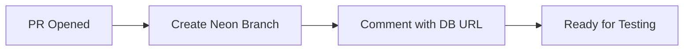
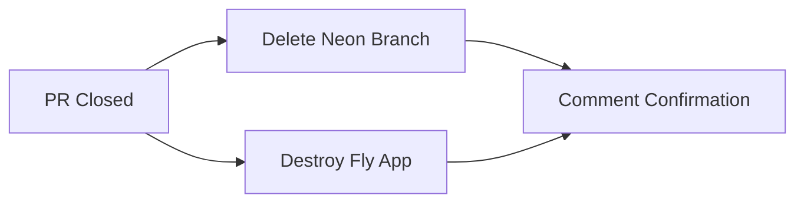

# GitHub Actions Workflows

This directory contains automated workflows for the SkateSpot Redux project.

## Workflows

### 1. Create/Delete Branch for Pull Request

**File**: `workflows/neon-branch.yml`

**Trigger**: Pull request events (opened, reopened, synchronized, closed)

**Purpose**: Automatically manages preview database branches for each pull request using Neon's database branching feature and the official Neon GitHub Integration.

**What it does**:

#### On PR Open/Update (opened, reopened, synchronize)
1. Creates a new Neon database branch named `preview/pr-{number}-{branch-name}`
2. The branch is an instant copy-on-write snapshot of the main database
3. Posts a comment on the PR with preview database information
4. Makes database connection strings available in workflow outputs

#### On PR Close (closed)
1. **Neon Cleanup**: Deletes the database branch `preview/pr-{number}-{branch-name}`
2. **Fly.io Cleanup**: Destroys the preview app `skatespot-pr-{number}` (if exists)
3. Posts confirmation comments on the PR

**Required Configuration**:
- `NEON_PROJECT_ID` variable (auto-created by Neon GitHub Integration)
- `NEON_API_KEY` secret (auto-created by Neon GitHub Integration)
- `FLY_API_TOKEN` secret (optional, only needed if using Fly.io preview apps)

**Jobs**:

#### setup
Extracts the branch name for use in other jobs.

#### create_neon_branch
Creates the preview database branch. Connection strings are available as job outputs:
- `db_url`: Direct connection string
- `db_url_with_pooler`: Connection string with pooling (recommended)

#### delete_neon_branch
Deletes the preview database branch when PR is closed.

#### cleanup_fly_app (Optional)
Attempts to destroy the Fly.io preview app. Uses `continue-on-error` to gracefully handle non-existent apps.

## Setup Instructions

### 1. Install the Neon GitHub Integration

The Neon GitHub Integration **automatically** sets up the required secrets and variables:

1. In the Neon Console, navigate to the **Integrations** page in your Neon project
2. Locate the **GitHub** card and click **Add**
3. Click **Install GitHub App**
4. Select your GitHub account and authorize the app
5. Choose whether to install for **All repositories** or **Only select repositories**
6. Select this GitHub repository to connect to your Neon project
7. Click **Connect**

This automatically creates:
- `NEON_API_KEY` secret in your GitHub repository
- `NEON_PROJECT_ID` variable in your GitHub repository

### 2. Add Optional Secrets (If Needed)

If using Fly.io preview apps, manually add:

Go to your GitHub repository → Settings → Secrets and variables → Actions

```
FLY_API_TOKEN=your-fly-token-here
```

### 3. Enable GitHub Actions

Ensure GitHub Actions is enabled for your repository:
- Settings → Actions → General
- Allow all actions and reusable workflows

### 4. Configure Workflow Permissions

Ensure workflows have permission to comment on PRs:
- Settings → Actions → General → Workflow permissions
- Select "Read and write permissions"
- Check "Allow GitHub Actions to create and approve pull requests"

## Workflow Behavior

### On PR Open/Update


### On PR Close


## Best Practices

### Database Migrations

When using preview databases, consider:

1. **Run migrations automatically** in your preview deployment pipeline
2. **Test migrations** against preview branches before merging
3. **Keep migrations idempotent** so they can run multiple times safely

### Cost Management

- Preview branches are **free** on Neon Pro tier
- Branches share storage via copy-on-write
- Clean up happens automatically on PR close
- Consider setting branch retention policies in Neon

### Testing with Preview Databases

Example workflow step to run tests with preview DB:

```yaml
- name: Run Integration Tests
  env:
    DATABASE_URL: ${{ steps.create-branch.outputs.db_url }}
  run: |
    cd backend_py
    pytest tests/
```

## Troubleshooting

### Workflow Fails with "Branch already exists"

**Cause**: The branch wasn't cleaned up properly from a previous PR with the same number.

**Solution**: Manually delete the branch from Neon dashboard, or close/reopen the PR.

### Workflow Fails with "Unauthorized"

**Cause**: Invalid or expired API keys.

**Solution**: 
1. Verify secrets are set correctly
2. Regenerate API keys in Neon dashboard
3. Update GitHub secrets

### Comment Not Posted

**Cause**: Insufficient workflow permissions.

**Solution**: 
1. Check Settings → Actions → General → Workflow permissions
2. Ensure "Read and write permissions" is selected

### Fly App Not Destroyed

**Cause**: App name doesn't match expected pattern or already deleted.

**Solution**: This is expected behavior. The workflow uses `continue-on-error: true` to handle missing apps gracefully.

## Monitoring

To view workflow runs:
1. Go to the **Actions** tab in your repository
2. Select a workflow from the left sidebar
3. Click on a specific run to see logs and details

## Future Enhancements

Potential improvements to consider:

- [ ] Add workflow to run migrations on preview databases
- [ ] Add workflow to seed preview databases with test data
- [ ] Add deployment workflow for production
- [ ] Add workflow to run E2E tests against preview environments
- [ ] Add Slack/Discord notifications for workflow status

## Resources

- [Neon GitHub Actions](https://github.com/marketplace/actions/neon-database-actions)
- [GitHub Actions Documentation](https://docs.github.com/en/actions)
- [Fly.io GitHub Actions](https://fly.io/docs/app-guides/continuous-deployment-with-github-actions/)
